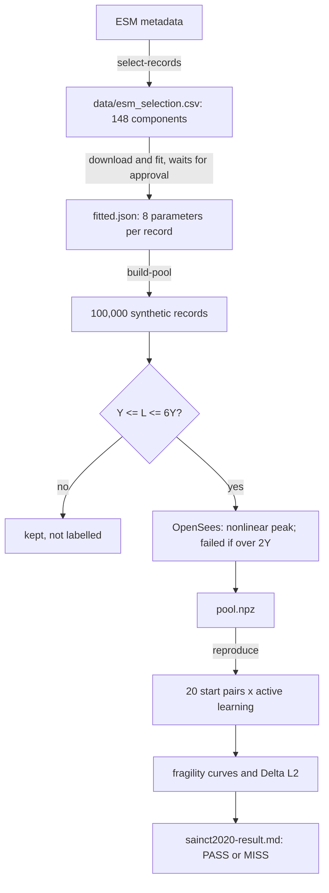

# Guide

How one reproduction run works, the words it uses, and where to change things.

## The flow: one run, from records to the verdict

1. **Choose the real records.** `simulation/esm.py: select_components` applies the
   paper's filter (5.5 < Mw < 6.5, under 20 km, before 2018-09-25, quality BEST or
   GOOD) to ESM's metadata. The result is pinned in `data/esm_selection.csv`.
2. **Fit each record** (waits for the download). `simulation/record_fit.py:
   fit_record` finds the 8 parameters: the envelope from the cumulative energy, the
   filter frequencies from zero up-crossings, the filter damping by simulation.
3. **Draw synthetic records.** `simulation/synthesis.py: draw_synthetic_specs` picks a
   fitted record at random and adds Gaussian noise (a kernel density), 100,000 times.
   Each draw keeps its parent's length and gets its own seed.
4. **Simulate and label.** `simulation/pool.py: build_pool` runs every draw on every
   core:
   - `simulation/ground_motion.py: simulate_ground_motion` makes the acceleration;
   - `pool.py: intensity_measures` computes PGA, PGV, PGD, energy and L;
   - records with L outside 1 to 6 times the yield are kept but not labelled;
   - `simulation/oscillator.py: nonlinear_peak_displacement` runs OpenSees, and a
     peak over twice the yield is a failure.
5. **Active learning.** `reproduction/sainct2020.py: run_reproduction` draws 20 start
   pairs, then for each one `surrogate/active_learning.py: run_active_learning` labels
   one record at a time, always the one closest to the SVM's hyperplane, and
   snapshots at 100 and 1,000 labels.
6. **Score it.** `surrogate/fragility.py`: turn scores into probabilities
   (`failure_probabilities`), group records by PGA, L or score (`group_by_value`), and
   compare with the true failure rates (`fragility_error`).
7. **Verdict.** `reproduction/report.py: format_report` writes the table next to the
   paper's and says PASS or MISS by the rule in `sainct2020.py: has_passed`.

## Glossary

| Term | Meaning | In the code |
|---|---|---|
| **Fragility curve** | The probability of failure as a function of how strong the shaking is | `surrogate/fragility.py` |
| **Surrogate** | A fast model that stands in for a slow simulation | `surrogate/` |
| **Active learning** | The model chooses which records to simulate next, here the ones it is least sure about, so fewer simulations are needed | `active_learning.py: run_active_learning` |
| **SVM** | Support vector machine: here a flat boundary (hyperplane) between "fails" and "doesn't fail" in feature space | `active_learning.py` |
| **Score** | A record's signed distance to the SVM's boundary; positive leans towards failure | `Snapshot.scores` |
| **PGA, PGV, PGD** | Peak ground acceleration, velocity and displacement | `pool.py: intensity_measures` |
| **L** | The peak displacement of the same oscillator kept linear: a measure of shaking tuned to this structure | `oscillator.py: linear_peak_displacement` |
| **Oscillator** | A single mass on a spring and damper: the simplest model of a structure | `oscillator.py: Oscillator` |
| **Yield, kinematic hardening** | Past the yield displacement the spring gets softer (20% of its stiffness) and its elastic range moves with it | `Steel01` in `oscillator.py` |
| **Envelope q(t)** | How a record's strength rises, holds and fades over time | `ground_motion.py: envelope` |
| **Box-Cox** | A power transform that makes skewed features closer to normal, before standardising | `active_learning.py: standardised_features` |
| **k-means groups** | Records split into groups of similar values, to draw a curve from many points | `fragility.py: group_by_value` |
| **ΔL2** | The weighted root mean square gap between the estimated curve and the true failure rates | `fragility.py: fragility_error` |
| **Pass rule** | What counts as reproducing the paper, written down before running | `sainct2020.py: has_passed` |

## Where to change things

- **The pass rule or the paper's numbers:** `reproduction/sainct2020.py`
  (`PAPER_TABLE_2`, `JUDGED_PROJECTION`). Change them only with a dated note in
  `docs/reproduction/sainct2020.md`.
- **The oscillator:** `simulation/oscillator.py: Oscillator` (frequency, damping,
  yield, post-yield stiffness).
- **Which records count:** the constants at the top of `simulation/esm.py`, then rerun
  `select-records`.
- **Accuracy against speed:** `SUBSTEPS_PER_SAMPLE` (OpenSees), `SYNTHETIC_TIME_STEP_S`
  and `IMPULSE_DECAY_CUTOFF` (ground motions).
- **The SVM and the error measure:** `SVM_REGULARIZATION` and `FRAGILITY_GROUP_COUNT`.
  Both were fixed before running; changing them after seeing a result is tuning.
