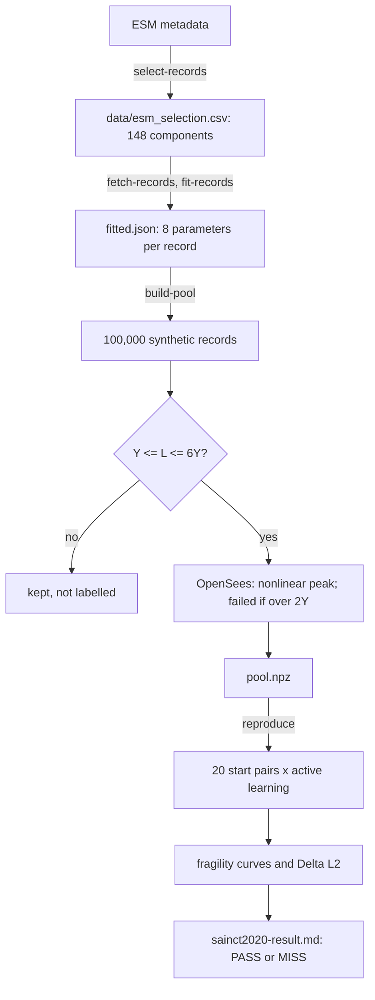
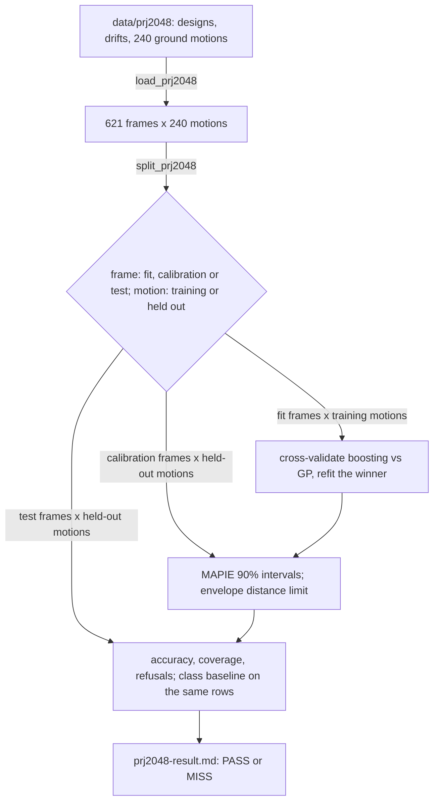

# Guide

How one run of each slice works, the words they use, and where to change things.
Slice 1 reproduces a paper on a single oscillator; slice 2 trains a building-level
surrogate on PRJ-2048.

## The flow: one run, from records to the verdict

1. **Choose the real records.** `simulation/esm.py: select_components` applies the
   paper's filter (5.5 < Mw < 6.5, under 20 km, before 2018-09-25, quality BEST or
   GOOD) to ESM's metadata. The result is pinned in `data/esm_selection.csv`.
2. **Fetch and fit each record.** `simulation/esm_records.py: fetch_recordings`
   downloads the zips and checks them against `data/esm_records.sha256`.
   `simulation/fit_all.py: fit_components` runs `simulation/record_fit.py: fit_record`
   on every component: the envelope and the quiet lead-in T0 from the cumulative
   energy, then, on the record after T0, the filter frequencies from zero up-crossings
   and the filter damping by simulation. A record that can't be fitted is listed and
   left out.
3. **Draw synthetic records.** `simulation/synthesis.py: draw_synthetic_specs` picks a
   fitted record at random and adds Gaussian noise (a kernel density), 100,000 times.
   Each draw keeps its parent's length and gets its own seed.
4. **Simulate and label.** `simulation/pool.py: build_pool` runs every draw on every
   core:
   - `simulation/ground_motion.py: simulate_ground_motion` makes the acceleration;
   - `pool.py: intensity_measures` computes PGA, PGV, PGD, energy and L;
   - records with L outside 1 to 6 times the yield are kept but not labelled;
   - `simulation/oscillator.py: nonlinear_peak_displacement` runs OpenSees, and a
     peak over twice the yield is a failure.
5. **Active learning.** `reproduction/sainct2020.py: run_reproduction` draws 20 start
   pairs, then for each one `surrogate/active_learning.py: run_active_learning` labels
   one record at a time, always the one closest to the SVM's hyperplane, and
   snapshots at 100 and 1,000 labels.
6. **Score it.** `surrogate/fragility.py`: turn scores into probabilities
   (`failure_probabilities`), group records by PGA, L or score (`group_by_value`), and
   compare with the true failure rates (`fragility_error`).
7. **Verdict.** `reproduction/report.py: format_report` writes the table next to the
   paper's and says PASS or MISS by the rule in `sainct2020.py: has_passed`.

## Slice 2: one run, from PRJ-2048 to the verdict

1. **Read the data.** `buildings/dataset.py: load_prj2048` reads each frame's six
   design numbers (`read_designs`), its peak drift under each ground motion, the
   largest over storeys (`read_peak_drifts`), and each ground motion's PGA and
   response spectrum at 0.2 to 4 s (`read_shaking`, `shaking_intensities`, using
   `simulation/linear_system.py: peak_oscillator_displacement`).
2. **Split.** `buildings/split.py: split_prj2048` puts each frame in exactly one of
   fit, calibration or test, stratified by storeys, and holds 48 ground motions out of
   training. `rows_for` pairs frames with motions into input rows;
   `is_split_clean` checks nothing leaks.
3. **Choose and fit.** `surrogate/building_model.py: cross_validate` scores gradient
   boosting and a Gaussian process on the fit rows, folds grouped by frame; `choose`
   takes the lower error; `fit_candidate` refits it.
4. **Intervals and envelope.** `buildings/experiment.py: train` wraps the model in
   MAPIE's `SplitConformalRegressor`, calibrated on the calibration rows, and builds
   `screening/envelope.py: TrainingEnvelope` from the fit and calibration rows.
5. **Judge.** `experiment.py: evaluate` measures the model and
   `surrogate/class_baseline.py: ClassBaseline` on the test rows; `has_passed`
   applies the pass rule; `buildings/report.py: format_report` writes the result and
   `save_model` the model with its hash.

## Glossary

| Term | Meaning | In the code |
|---|---|---|
| **Fragility curve** | The probability of failure as a function of how strong the shaking is | `surrogate/fragility.py` |
| **Surrogate** | A fast model that stands in for a slow simulation | `surrogate/` |
| **Active learning** | The model chooses which records to simulate next, here the ones it is least sure about, so fewer simulations are needed | `active_learning.py: run_active_learning` |
| **SVM** | Support vector machine: here a flat boundary (hyperplane) between "fails" and "doesn't fail" in feature space | `active_learning.py` |
| **Score** | A record's signed distance to the SVM's boundary; positive leans towards failure | `Snapshot.scores` |
| **PGA, PGV, PGD** | Peak ground acceleration, velocity and displacement | `pool.py: intensity_measures` |
| **L** | The peak displacement of the same oscillator kept linear: a measure of shaking tuned to this structure | `oscillator.py: linear_peak_displacement` |
| **Oscillator** | A single mass on a spring and damper: the simplest model of a structure | `oscillator.py: Oscillator` |
| **Yield, kinematic hardening** | Past the yield displacement the spring gets softer (20% of its stiffness) and its elastic range moves with it | `Steel01` in `oscillator.py` |
| **Envelope q(t)** | How a record's strength rises, holds and fades over time | `ground_motion.py: envelope` |
| **Box-Cox** | A power transform that makes skewed features closer to normal, before standardising | `active_learning.py: standardised_features` |
| **k-means groups** | Records split into groups of similar values, to draw a curve from many points | `fragility.py: group_by_value` |
| **ΔL2** | The weighted root mean square gap between the estimated curve and the true failure rates | `fragility.py: fragility_error` |
| **T0, lead-in** | The quiet stretch before the shaking starts in a real record; fitted, then dropped | `record_fit.py: fit_envelope` |
| **Checksum** | A fingerprint (SHA-256) of a downloaded file, pinned so a changed file is caught | `esm_records.py` |
| **Pass rule** | What counts as success, written down before running | `sainct2020.py: has_passed`, `experiment.py: has_passed` |
| **PRJ-2048** | A public dataset of 621 steel moment frames, each simulated in OpenSees under 240 ground motions | `buildings/dataset.py` |
| **Inter-storey drift ratio** | How far one floor moves sideways relative to the floor below, divided by the storey height. The usual measure of structural damage | `read_peak_drifts` |
| **Sa(T), response spectrum** | The peak acceleration a simple oscillator with period T feels in the shaking (5% damping); the spectrum lists it over many periods | `shaking_intensities` |
| **Split by frame** | Test frames never appear in training, under any ground motion, so the error measures new buildings | `buildings/split.py` |
| **Gradient boosting, Gaussian process** | The two candidate surrogates: many small decision trees added up, and a smooth function with its own uncertainty | `building_model.py` |
| **Conformal interval, coverage** | A range around each prediction, sized on held-out calibration rows so it holds the true value 90% of the time; coverage is how often it actually does on test | `experiment.py: train`, MAPIE |
| **Training envelope, refusal** | The region of inputs the model learned from; outside it, the answer is a refusal with the reason, never a number | `screening/envelope.py` |
| **Hazus, class baseline** | FEMA's loss model groups buildings into classes (here steel frames, low, mid or high-rise) and treats each class alike; the baseline does the same | `class_baseline.py` |

## Where to change things

- **The pass rule or the paper's numbers:** `reproduction/sainct2020.py`
  (`PAPER_TABLE_2`, `JUDGED_PROJECTION`). Change them only with a dated note in
  `docs/reproduction/sainct2020.md`.
- **The oscillator:** `simulation/oscillator.py: Oscillator` (frequency, damping,
  yield, post-yield stiffness).
- **Which records count:** the constants at the top of `simulation/esm.py`, then rerun
  `select-records`.
- **Accuracy against speed:** `SUBSTEPS_PER_SAMPLE` (OpenSees), `SYNTHETIC_TIME_STEP_S`
  and `IMPULSE_DECAY_CUTOFF` (ground motions).
- **The SVM and the error measure:** `SVM_REGULARIZATION` and `FRAGILITY_GROUP_COUNT`.
  Both were fixed before running; changing them after seeing a result is tuning.
- **Slice 2's split, models and intervals:** `SPLIT_SEED` and the shares in
  `buildings/split.py`; `BOOSTING_*` and `GP_SAMPLE_ROWS` in `building_model.py`;
  `CONFIDENCE_LEVEL` and `COVERAGE_BAND` in `buildings/experiment.py`. All were fixed
  before the run (`docs/building-surrogate/prj2048.md`); changing them needs a dated
  note there.
- **Which shaking inputs the surrogate uses:** `SPECTRAL_PERIODS_S` in
  `buildings/dataset.py`. The envelope and the baseline follow it.
- **How strict the refusals are:** `ACCEPTED_CALIBRATION_PERCENTILE` in
  `screening/envelope.py`.
